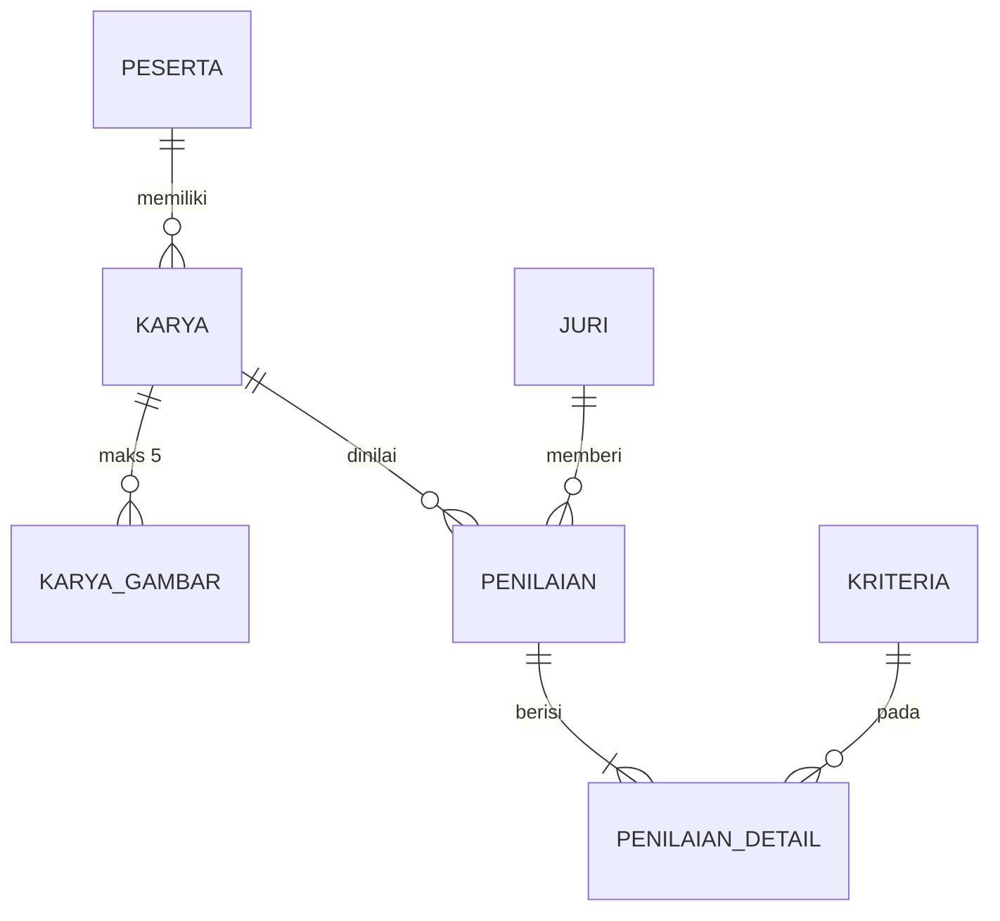

# PRD — Aplikasi Penjurian "MBtech Riding With Style Awards 2026"

| | |
|---|---|
| **Versi** | 1.0 (berdasarkan jawaban stakeholder) |
| **Tanggal** | 10 Nov 2026 |
| **Platform** | Web App + PWA (target utama: smartphone juri) |
| **Database** | MySQL 8 |
| **Prinsip** | Akurat, andal, tidak ada data hilang. Tanpa fitur gimmick. |

---

## 1. Ringkasan

Aplikasi penjurian kompetisi modifikasi jok motor **MBtech RWSA 2026**. Admin mendaftarkan peserta dan karya (beserta foto). Juri login masing-masing lewat smartphone dan menilai karya **langsung di depan karya fisik**. Nilai dihitung otomatis berbobot sesuai Rules & Regulation. Admin memantau **ranking live** selama penjurian.

## 2. Tujuan & Non-Tujuan

**Tujuan**
1. Perhitungan nilai 100% akurat dan dapat diaudit.
2. Tidak ada nilai juri yang hilang, walaupun koneksi terputus atau perangkat bermasalah (Bagian 8).
3. Penilaian cepat dan minim salah-klik di smartphone.
4. Ranking live untuk admin selama event.

**Non-Tujuan (v1)**
- Login/portal peserta, voting publik, pembayaran, notifikasi WA/email, kategori lomba, deadline otomatis.
- Penilaian offline penuh. Koneksi internet **wajib** untuk submit final.

## 3. Peran Pengguna

| Role | Hak |
|---|---|
| **Admin** | Kelola peserta, karya, foto, juri, kriteria; atur fase event; lihat ranking live & rekap; unlock nilai; backup/export; input nilai atas nama juri (fallback) |
| **Juri** | Login sendiri; melihat semua karya; menilai; melihat nilai miliknya saja |

Tidak ada role peserta. Semua data peserta & karya diinput admin.

## 4. Kriteria Penilaian (sumber: poster)

| # | Kriteria | Bobot | Deskripsi |
|---|---|---|---|
| 1 | Kreativitas Design | 30% | Design jok yang eksklusif, unik dan menarik |
| 2 | Kreativitas Pola & Grafis | 30% | Keserasian pola, paduan warna & detail grafis pada design jok |
| 3 | Kualitas Pengerjaan | 20% | Kerapihan aspek jahitan dan pemasangan |
| 4 | Kenyamanan & Penampilan | 20% | Aspek kenyamanan jok saat diduduki serta penampilannya |

### Aturan Perhitungan
```
Langkah 1 (per juri)  : Skor Juri_j  = (N1 × 0,30) + (N2 × 0,30) + (N3 × 0,20) + (N4 × 0,20)
Langkah 2 (semua juri): TOTAL        = Σ Skor Juri_j            (jumlah nilai semua juri)
                        RATA-RATA    = TOTAL ÷ J                J = jumlah juri yang Submit Final
```
- **Hasil akhir ada 2: Total dan Rata-rata. Keduanya ditampilkan di ranking dan rekap.**
- **Peringkat diurutkan berdasarkan Rata-rata.** Karena peringkat resmi hanya memuat karya yang dinilai semua juri aktif (J sama untuk semua karya), urutan berdasarkan Total identik dengan urutan Rata-rata.
- Langkah 1 = jumlah nilai berbobot, sehingga skala tetap 0–100.
- Rata-rata membagi dengan J, sehingga **tidak terpengaruh jumlah juri** (tetap skala 0–100). Total bergantung pada J (maksimum 100 × J), sehingga hanya dibandingkan antar karya yang J-nya sama.
- Hasilnya identik jika dihitung dengan urutan terbalik (rata-rata tiap kriteria dulu, baru dikali bobot). Sistem memakai satu cara saja dan diuji silang dengan cara satunya.
- Karya hanya masuk peringkat resmi jika **semua juri aktif** sudah Final, supaya perbandingan antar karya adil (J sama).
- Nilai per kriteria: **bilangan bulat 0–100** (lihat A1).
- Perhitungan memakai tipe `DECIMAL` (bukan float). Pembulatan hanya untuk tampilan, 2 desimal. Presisi penuh dipakai untuk pengurutan.
- Bobot disimpan di DB; total bobot wajib tepat 100% (divalidasi). Kriteria **terkunci** begitu ada nilai yang masuk.
- **Tie-breaker** (lihat A2): Rata-rata sama → rata-rata Kreativitas Design → Kreativitas Pola & Grafis → Kualitas Pengerjaan → Kenyamanan & Penampilan → ditetapkan manual oleh dewan juri (ditandai "SERI" di rekap).
- Contoh uji: 80/90/70/60 → 24 + 27 + 14 + 12 = **77,00**.

## 5. Fitur

### 5.1 Autentikasi
- Login terpisah Admin/Juri. Password hash (argon2/bcrypt), rate-limit, session aman, HTTPS wajib.
- Akun juri dibuat admin; wajib ganti password saat login pertama; reset oleh admin.
- Satu juri = satu akun. Sesi aktif ditampilkan ke admin (opsional).

### 5.2 Peserta (Admin)
- Field: **ID Peserta (akronim)**, **Nama**, **Deskripsi**.
- Akronim unik, huruf kapital A–Z/0–9, 2–5 karakter. Tidak bisa diubah/dihapus bila sudah punya karya.
- CRUD, pencarian, export CSV.

### 5.3 Juri (Admin)
- Field: **ID Juri**, **Nama**, username, password, status aktif.
- CRUD, aktif/nonaktif, reset password.

### 5.4 Karya (Admin) — "Form Submit Karya"
- Satu peserta → banyak karya.
- Field: peserta (pilih), nama karya, **akronim karya**, deskripsi.
- **ID Karya otomatis** = `AKRONIM PESERTA` + `AKRONIM KARYA` + `NOURUT`.
  - **Nomor urut per peserta**, berurutan mulai 001 dari semua karya milik peserta itu.
  - Contoh: peserta `BRM` → karya pertama `CLS` = **BRM-CLS-001**; karya kedua `VNT` = **BRM-VNT-002**.
  - Separator "-" hanya tampilan; penyimpanan dan pencarian tetap konsisten.
- Nomor urut dibuat di dalam transaksi DB dengan row lock → tidak mungkin dobel. Nomor tidak dipakai ulang bila karya dihapus (tidak ada hard delete setelah dinilai).
- ID karya **immutable**.

### 5.5 Foto Karya (Admin)
- **Maksimal 5 foto per karya**, minimal 1.
- JPG/PNG/WebP; maksimal 10 MB/file sebelum kompresi. Kompresi di sisi client sebelum upload, lalu resize dan thumbnail di server.
- Validasi MIME asli, nama file diacak, strip EXIF/GPS.
- Pilih cover, atur urutan, hapus/ganti foto.
- Bisa ambil foto langsung dari kamera HP.

### 5.6 Fase Event (Admin)
Tanpa deadline. Admin mengatur fase secara manual:

| Fase | Perilaku |
|---|---|
| **Persiapan/Registrasi** | Admin bebas CRUD; juri belum bisa menilai |
| **Penjurian** | Juri bisa menilai. Data karya dikunci dari penghapusan; edit nama/deskripsi tercatat di audit log |
| **Selesai** | Semua nilai read-only. Hasil final dan berita acara bisa diekspor |

### 5.7 Portal & Panel Penilaian Juri (mobile-first)
- **Daftar karya**: pencarian cepat berdasarkan ID karya/nama peserta, filter *Belum dinilai / Draft / Final*, progres "x / total".
- **Halaman nilai per karya**:
  - Header besar: **ID Karya + nama peserta + nama karya** (agar tidak salah karya).
  - Galeri foto referensi (swipe, zoom).
  - 4 input nilai 0–100 (angka langsung, dengan stepper/slider sebagai bantuan) disertai deskripsi kriteria.
  - **Skor berbobot tampil real-time**.
  - Catatan opsional.
- Aksi: **autosave draft**, lalu **Submit Final** dengan dialog konfirmasi yang menampilkan ulang ID karya + 4 nilai + skor total.
- Indikator status sinkron selalu terlihat: `Tersimpan di server` / `Menunggu sinkron` / `Offline`.
- Juri hanya melihat nilai miliknya. Nilai final terkunci; hanya admin yang bisa unlock (tercatat di audit log).
- Semua juri menilai semua karya (lihat A3).

### 5.8 Ranking Live & Rekap (Admin)
- Tabel ranking: peringkat, ID karya, peserta, karya, **Total**, **Rata-rata**, **jumlah juri final (mis. 3/5)**, rincian per juri dan per kriteria. Urutan berdasarkan Rata-rata.
- Update otomatis lewat polling tiap 10–15 detik (sederhana dan andal; tanpa websocket).
- Hanya nilai berstatus **Final** yang dihitung. Karya yang belum dinilai semua juri ditandai **"Belum lengkap"** agar tidak disalahartikan, dan dipisah dari peringkat resmi.
- Monitor progres tiap juri (jumlah karya final/draft/belum).
- Export Excel/PDF (berita acara Juara 1–3).

### 5.9 Audit Log
Mencatat login, perubahan/submit nilai, unlock, input nilai atas nama juri, perubahan karya, perubahan fase, backup/export. Log tidak bisa diedit atau dihapus dari UI.

### 5.10 PWA
- Manifest, ikon, installable (Add to Home Screen), service worker untuk cache app shell dan aset, layar offline yang jelas.
- **Responsif untuk smartphone dan tablet** (web app yang diperlakukan sebagai aplikasi mobile): smartphone portrait sebagai prioritas utama; tablet (portrait dan landscape) memakai layout dua kolom (foto/info di satu sisi, form nilai di sisi lain). Admin juga bisa dipakai di desktop.
- Area sentuh minimal 44px; input angka memakai keyboard numerik (`inputmode="numeric"`); tanpa hover-only interaction; menghormati safe-area (notch) dan mencegah zoom tak sengaja pada input.

## 6. Alur Utama

```mermaid
flowchart LR
    A[Admin setup: kriteria, akun juri] --> B[Admin input peserta]
    B --> C[Admin input karya + maks 5 foto, ID otomatis]
    C --> D[Admin buka fase Penjurian]
    D --> E[Juri menilai di depan karya]
    E --> F[Autosave draft lokal + server]
    F --> G[Submit Final, online, konfirmasi]
    G --> H[Ranking live admin]
    H --> I[Admin tutup fase, export berita acara]
```



## 7. Model Data (MySQL)



| Tabel | Kolom Utama |
|---|---|
| `users` | id, role (admin/juri), username, password_hash, is_active, must_change_password |
| `peserta` | id, kode_peserta (UNIQUE), nama, deskripsi, deleted_at |
| `juri` | id, kode_juri (UNIQUE), nama, user_id, is_active |
| `karya` | id, peserta_id, akronim_karya, no_urut, **kode_karya (UNIQUE)**, nama_karya, deskripsi. UNIQUE(peserta_id, no_urut) |
| `karya_gambar` | id, karya_id, path, thumb_path, urutan, is_cover. Max 5/karya (validasi aplikasi dan trigger/constraint) |
| `kriteria` | id, kode, nama, deskripsi, bobot DECIMAL(5,2), urutan |
| `penilaian` | id, **client_uuid**, juri_id, karya_id, status (draft/final), catatan, skor_total DECIMAL(6,2), version, finalized_at, input_by (juri/admin). **UNIQUE(juri_id, karya_id)** |
| `penilaian_detail` | id, penilaian_id, kriteria_id, nilai TINYINT (CHECK 0–100), bobot_snapshot. UNIQUE(penilaian_id, kriteria_id) |
| `event_setting` | fase aktif, nama event, dll. |
| `audit_log` | id, user_id, aksi, entitas, entitas_id, data_lama/baru (JSON), ip, created_at |
| `penilaian_history` | riwayat setiap perubahan nilai, append-only |

Catatan integritas:
- `CHECK (nilai BETWEEN 0 AND 100)` di level DB, bukan hanya di UI.
- `bobot_snapshot` disimpan saat final, sehingga hasil tidak berubah walau konfigurasi berubah.
- Skor total dihitung di server. Hasil hitung client hanya tampilan.
- Request autosave/submit bersifat **idempoten** (client_uuid + version) sehingga retry aman dan data lama tidak menimpa data baru.

## 8. Strategi Backup & Keandalan Data

Prinsip: **tidak ada nilai juri yang boleh hilang**.

| Lapis | Mekanisme |
|---|---|
| **1. Draft lokal (perangkat juri)** | Setiap perubahan nilai langsung disimpan ke IndexedDB sebelum dikirim. HP mati atau tab tertutup, draft tetap ada |
| **2. Sync queue + retry** | Draft otomatis dikirim ke server dengan retry/backoff. Sinkron saat koneksi pulih (event `online` + polling, karena Background Sync tidak didukung iOS Safari) |
| **3. Submit Final harus online** | Dianggap final **hanya setelah server mengirim konfirmasi**. Jika offline, tombol nonaktif dan draft tetap aman. Status "Menunggu sinkron" tidak boleh dianggap terkirim |
| **4. Backup database** | `mysqldump` otomatis: harian, plus tiap jam selama fase Penjurian; disimpan di luar server aplikasi (cloud storage/server lain). Tombol **"Backup sekarang"** untuk admin. Retensi minimal 14 hari |
| **5. Export kapan saja** | Admin dapat export seluruh nilai (Excel/CSV) dan ranking kapan saja; sebaiknya dilakukan di akhir sesi sebagai arsip |
| **6. Fallback manual** | Lembar penilaian cetak (PDF) per juri/karya. Jika HP juri bermasalah, admin dapat **input nilai atas nama juri**, ditandai `input_by=admin` dan tercatat di audit log |
| **7. Tanpa hard delete** | Soft delete untuk peserta/karya/juri, `penilaian_history` append-only |

Catatan teknis: pada iOS, data situs yang jarang dibuka bisa dibersihkan oleh sistem. Selama event ini tidak jadi masalah, terutama jika PWA di-install ke home screen. Draft lokal bukan satu-satunya salinan karena server ikut menyimpan autosave.

## 9. Branding & UI/UX

- Mengacu poster: **latar hitam, aksen emas**, tipografi serif elegan untuk judul dan sans-serif bersih untuk data, logo MBtech & RWSA 2026.
- Kesan **premium & elegan**: kontras tinggi, spasi lega, tanpa animasi berlebihan, tanpa efek dekoratif yang mengganggu keterbacaan.
- Prioritas: keterbacaan di bawah cahaya outdoor/indoor event, tombol besar, hierarki informasi jelas.
- Perlu aset resmi: logo vektor/PNG transparan, font, kode warna emas (jika ada).

## 10. Kebutuhan Non-Fungsional

| Aspek | Target |
|---|---|
| Skala | Kecil (skala kota): estimasi ≤ 200 peserta, ≤ 400 karya, ≤ 15 juri (lihat A4) |
| Performa | Halaman utama < 2 dtk di 4G; submit nilai < 1 dtk; foto lazy-load dan thumbnail |
| Keamanan | HTTPS, CSRF, XSS/SQLi (ORM/prepared statements), RBAC, rate-limit, validasi upload, security headers |
| Ketersediaan | Selama event: monitoring uptime dan error log, backup per jam |
| Kompatibilitas | Chrome Android (utama), Safari iOS 16.4+; viewport smartphone (≥ 360px) dan tablet (≥ 768px) |
| Bahasa | Bahasa Indonesia |

## 11. Tech Stack (Usulan)

| Layer | Pilihan |
|---|---|
| Framework | **Next.js (App Router) + TypeScript**, fullstack (UI dan API/Server Actions dalam satu proyek) |
| ORM / DB | **Prisma + MySQL 8** (InnoDB, utf8mb4). `CHECK` (nilai 0–100) dan batas 5 foto dibuat lewat raw SQL migration, karena Prisma tidak mendukungnya secara native |
| Auth | Session berbasis cookie httpOnly (Auth.js Credentials atau implementasi sendiri), hash argon2, RBAC admin/juri di middleware dan di setiap server action |
| Validasi | Zod (dipakai bersama di client dan server) |
| UI | Tailwind CSS, tema hitam-emas |
| PWA | Serwist (service worker untuk Next.js), manifest, IndexedDB (Dexie) untuk draft lokal |
| Gambar | `sharp` (resize, thumbnail, strip EXIF) |
| Backup | Cron `mysqldump` + upload ke storage terpisah |
| Deploy | VPS kecil + Node.js (PM2 atau Docker) + Nginx + HTTPS (Let's Encrypt). Next.js butuh server Node, bukan shared hosting PHP biasa |

## 12. Kriteria Penerimaan

1. Admin dapat membuat peserta, lalu 2 karya dengan 5 foto; ID karya sesuai format (BRM-CLS-001, BRM-VNT-002); upload foto ke-6 ditolak.
2. Pembuatan karya konkuren oleh 2 admin tidak menghasilkan ID ganda.
3. Nilai di luar 0–100 ditolak (UI, API, dan DB).
4. Skor Juri, **Total**, dan **Rata-rata** sesuai perhitungan manual (contoh 80/90/70/60 → 77,00), diuji dengan ≥ 20 kasus uji.
5. Juri A tidak bisa melihat atau mengubah nilai juri B (diuji lewat UI dan API).
6. Nilai Final tidak bisa diubah juri; unlock oleh admin tercatat di audit log.
7. **Uji gangguan koneksi**: koneksi dimatikan saat mengisi, nilai tetap ada setelah tab ditutup lalu dibuka lagi, dan tersinkron otomatis ketika online. Submit Final saat offline tidak bisa dilakukan.
8. **Uji retry**: request ganda atau berulang tidak menghasilkan data ganda (idempoten).
9. Ranking live admin ter-update ≤ 15 detik setelah juri Submit Final; karya "Belum lengkap" ditandai dan tidak masuk peringkat resmi.
10. Backup otomatis berjalan dan restore berhasil diuji di server lain sebelum hari-H.
11. PWA dapat di-install di Android dan iOS; tampilan sesuai branding.

## 13. Milestone (Estimasi)

| Fase | Isi | Estimasi |
|---|---|---|
| 0 | Konfirmasi asumsi, wireframe dan desain UI (hitam-emas) | 3–5 hari |
| 1 | Setup, auth, RBAC, CRUD peserta/juri/kriteria, fase event | 1 minggu |
| 2 | Karya, generator ID, upload foto (maks 5) | 1 minggu |
| 3 | Portal juri, autosave lokal + sync, Submit Final, perhitungan skor | 1,5 minggu |
| 4 | Ranking live, rekap/export, audit log, backup otomatis, fallback manual | 1 minggu |
| 5 | UAT + simulasi penjurian dengan juri, uji gangguan, restore backup, deploy | 1 minggu |

## 14. Risiko & Mitigasi

| Risiko | Mitigasi |
|---|---|
| Sinyal buruk di venue | Draft lokal + retry, indikator status jelas, siapkan hotspot cadangan, lembar cetak fallback |
| Juri salah memilih karya | ID karya besar di header, dialog konfirmasi sebelum final |
| Salah hitung/pembulatan | DECIMAL, hitung di server, kasus uji, snapshot bobot |
| Sengketa hasil | Audit log, history append-only, berita acara ekspor |
| Server/DB bermasalah | Backup per jam, restore teruji, export mandiri |
| HP juri rusak/habis baterai | Fallback input admin atas nama juri, login ulang dari perangkat lain tanpa kehilangan draft server |

## 15. Asumsi yang Perlu Dikonfirmasi

| # | Asumsi | Default PRD |
|---|---|---|
| A1 | Nilai per kriteria **bilangan bulat** 0–100 (bukan desimal) | Bulat |
| A2 | Jika Skor Akhir seri, tie-breaker memakai urutan kriteria berbobot terbesar | Seperti Bagian 4 |
| A3 | **Semua juri menilai semua karya** | Ya |
| A4 | Jumlah juri sekitar 3–15 dan peserta ≤ 200 | Ya |
| A5 | Hasil akhir ada 2: **Total** (jumlah skor semua juri) dan **Rata-rata**; peringkat diurutkan berdasarkan Rata-rata | **Terkonfirmasi** (dasar peringkat: Rata-rata) |
| A6 | Ranking resmi hanya untuk karya yang dinilai **semua juri aktif** | Ya |
| A7 | Hosting belum ditentukan; karena Next.js, saran VPS kecil (Node.js) dengan HTTPS | Ya |
