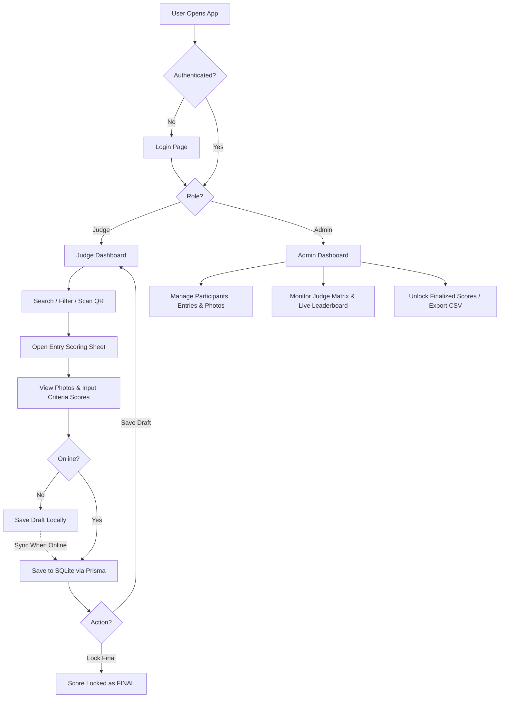

# Judging & Scoring PWA

A lightweight, offline-capable Progressive Web App (PWA) for event judging and competition scoring, built with **Next.js (App Router)**, **Prisma**, and **SQLite**.

---

## ✨ Key Features

- **Role-Based Access Control**: Separate portals for **Administrators** and **Judges** with Argon2 password hashing and HTTP-only session cookies.
- **Weighted Criteria Scoring**: Configurable judging criteria with percentage weights, real-time score calculation, and automatic tie-breaking rules.
- **Draft & Final Locking**: Judges can save scores as `DRAFT` (auto-saved locally when offline) or lock them as `FINAL`. Administrators can unlock finalized scores if revisions are needed.
- **QR Code & Entry Lookup**: Fast search by entry code, title, or participant, plus built-in camera QR code scanning.
- **Photo Gallery & Compression**: Multi-photo upload per entry with automatic WebP conversion and thumbnail generation via `sharp`.
- **Live Leaderboard & Judge Matrix**: Real-time rankings, per-judge score matrix, and official CSV export for spreadsheets.
- **Offline-First PWA**: Installable on mobile devices with Service Worker caching and IndexedDB/local draft synchronization.

---

## 🔀 Application Flowchart



---

## ⚡ Standalone (`dist-deploy`) vs Standard `next start`

| Aspect | Standalone (`dist-deploy` / `node server.js`) | Standard `npm start` (`next start`) |
| :--- | :--- | :--- |
| **RAM Usage** | **Much lower (~28 MB idle)** — loads only minimal traced runtime files via `server.js`. | Higher — loads the full `node_modules` tree. |
| **Deployment Size** | Lightweight and self-contained; no `devDependencies` required on the server. | Requires full `node_modules` installation on the target server. |
| **Best For** | Low-RAM VPS (512 MB–1 GB), aaPanel Node projects, and occasional event hosting. | Servers with ample RAM where you build directly on the host. |

---

## 🚀 Quick Start (Local / Production)

### 1. Environment Configuration
Copy `.env.example` to `.env` and configure your database and admin credentials:

```bash
cp .env.example .env
```

```env
DATABASE_URL="file:./judging.db"
STORAGE_DIR="./storage"
BACKUP_DIR="./storage/backups"
SEED_ADMIN_USERNAME="admin"
SEED_ADMIN_PASSWORD="your_secure_password"
```

### 2. Install, Migrate & Seed
```bash
npm install
npx prisma generate
npx prisma db push
npm run db:seed
```

### 3. Build & Run
```bash
# Development
npm run dev

# Production (Standalone)
npm run build
npm run start:standalone
```

To generate a self-contained deployment bundle (`dist-deploy/` and `.zip`):
```bash
npm run bundle
```
